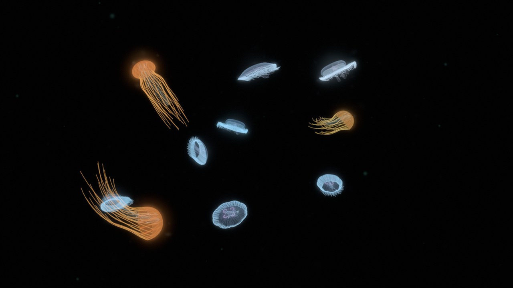
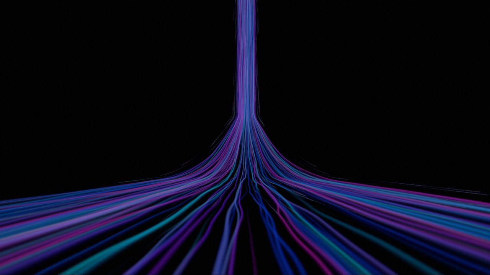
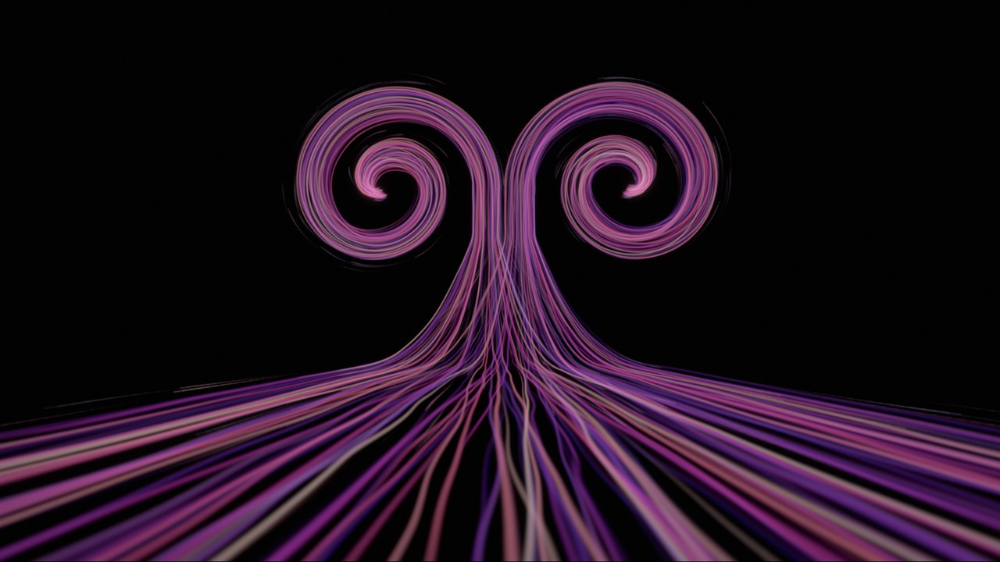
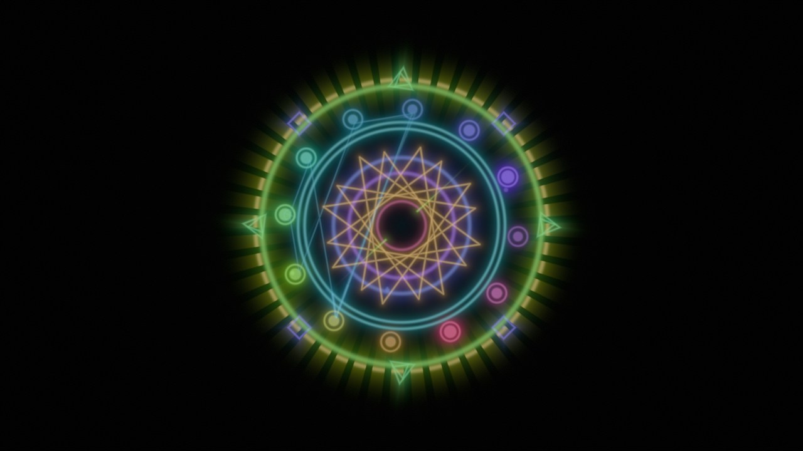
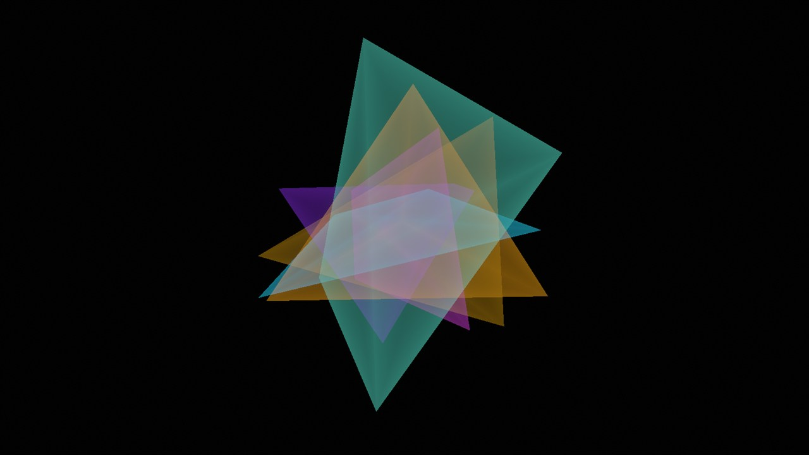
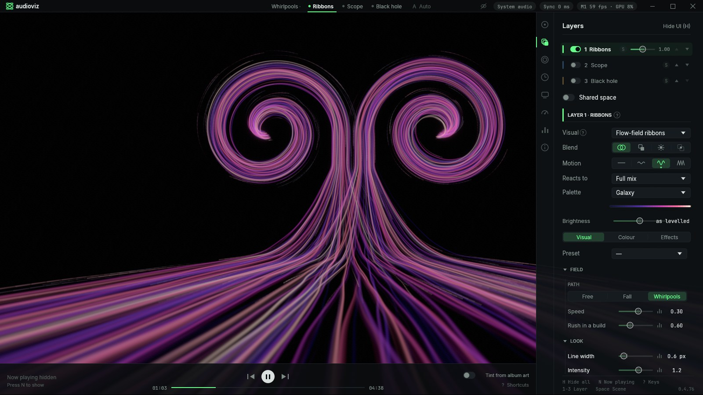

# audioviz

A music visualizer for whatever Windows is playing, Spotify first. Native Rust, wgpu and WGSL: lines, light and space that move with the music. Not a MilkDrop clone.

| Jellyfish | Waterfall | Whirlpools | Sigil |
|---|---|---|---|
|  |  |  |  |

| Black hole | Crystal | Kaleidoscope | Settings panel |
|---|---|---|---|
|  |  |  |  |

> [!NOTE]
> audioviz is written by Claude Code (Anthropic's coding agent) under Greg Douglas's direction. [`AI_DISCLOSURE.md`](AI_DISCLOSURE.md) says exactly how.

## What it does

- **30 visuals.** Among them: a phosphor XY oscilloscope of the real stereo signal; flow-field ribbons (free, falling or in whirlpools); a ray-traced black hole; deep-sea jellyfish in a 3D tank; the Sigil, a neon glyph rebuilt for every track; glass crystals; and Bug eyed, eyes that follow the music, as cartoons or hyper-real. Classic analysers too: spectrum bars, a spectrogram, waves and a tunnel. The full list is in [`docs/visuals.md`](docs/visuals.md).
- **43 factory scenes.** A scene stacks up to three *layers*. Each layer is one visual with its own controls, opacity, audio band (the full mix, or just the bass, the air and so on) and blend mode.
- **17 effects**, chained per layer and moved by the music:
  - Shape: kaleidoscope, mirror, fractal, polar, warp, ripple, mask.
  - Colour: palette, colorify, halftone, edge, chroma split.
  - Light and time: glow, luminescence, feedback, scanlines, vignette.
- **Palettes reach everything:** phosphor, techno, neon, rave, 80s pop, galaxy, fire, ice, sunset, mono, or your own stops.
- **Real-time analysis**: bands, loudness, onsets, a predictive beat clock and chroma. Two directors change scenes and effects on track changes, drops and quiet passages.
- **Your own visuals.** A visual is two files in a folder, `visual.json` and `visual.wgsl`, and it reloads when you save either. Guide: [`docs/building-visuals.md`](docs/building-visuals.md).
- **Private by design:** no telemetry, no accounts, no network unless you press *Check for updates* ([`PRIVACY.md`](PRIVACY.md)).

## Install

Windows 10 2004+ or Windows 11, with a DirectX 12 or Vulkan GPU.

> [!IMPORTANT]
> The latest published release is [0.1.0](https://github.com/gregodouglas/audioviz/releases/latest), from before most of what is described here. `main` is at 0.4.x and has no release yet; to run it now, [build from source](#build-from-source).

- **Installer:** `audioviz-<version>-setup.exe` from the [releases page](https://github.com/gregodouglas/audioviz/releases). It installs per-user (no admin prompt) into `%LOCALAPPDATA%\Programs\audioviz`, adds a Start Menu shortcut and can start when you sign in.
- **Portable:** unzip `audioviz-<version>-portable-win64.zip` anywhere and run `audioviz.exe`.

Releases are not yet code-signed, so Windows SmartScreen shows "Windows protected your PC" the first time. Click *More info* → *Run anyway*, or check the file against `SHA256SUMS.txt` on the release page first.

Start Spotify, play something, start audioviz. If Spotify is not running, audioviz visualizes the default output device instead and says so. For music playing elsewhere (a TV, a hi-fi), Sync › Source › *The room* listens through a microphone.

## Use

The window is frameless. Move the mouse and a thin bar appears at the top (scene pips, status, window controls) with a transport strip at the bottom (album art, previous / play-pause / next, progress). Both hide after three seconds and in fullscreen. On the first run a welcome sheet asks for the monitor, offers the delay calibration and lets you pick a scene.

Press **Tab** for the settings panel. Its sections are:

- **Scenes**: pick, save, and the auto director.
- **Layers**: the stack of three, then the edited layer's Visual, Colour and Effects.
- **Picture**: exposure, bloom, grain, tint.
- **Sync**: delay, calibration, source.
- **Display**: monitor, frame cap, reduce flashing.
- **Performance**, **Meters** and **About** (update check, diagnostics).

Controls dim at their default and reset on a double-click.

| Key | Action |
|---|---|
| Tab | Settings panel |
| H | Hide everything (H or Tab shows it again) |
| 1 / 2 / 3 | Layer to edit |
| Space | Next scene |
| A | Auto scene director |
| N | Show what is playing |
| C | Calibrate the audio delay (tap Space on the beat, Enter applies) |
| D | Director view: what the engine hears (F freezes, L linear or log, S saves the last two minutes) |
| F11 | Fullscreen on this monitor |
| ? | All shortcuts |
| Esc | Close sheet · close panel · leave fullscreen · quit |

The tray icon switches scenes, toggles the director, goes fullscreen on a chosen monitor and quits. `audioviz --tray` starts hidden in the tray (what "start when I sign in" uses).

**Audio delay.** Loopback hears the audio before your ears do, so the picture leads the sound by your output latency: about 10-40 ms on wired headphones, 100-250 ms on Bluetooth. Press **C** and tap along for ten beats; the app measures the offset and offers to apply it.

**Reduce flashing** (Display) is on by default. It caps how fast the picture may brighten between frames, for photosensitive viewers.

**On a TV (experimental).** Display › Cast to a TV opens the Windows cast panel (Win+K) for a Roku or any Miracast television. Once the TV shows up as a display, one click puts the visualizer fullscreen on it.

Settings live in `%APPDATA%\audioviz\settings.json` (plain JSON; delete it to reset). Scenes, presets and visuals, the shipped ones included, are files in folders beside it that you can edit. A shipped file you never edited updates itself when a newer version ships. `audioviz --version` prints the version; `audioviz --set key=value` changes a setting before starting.

## Build from source

You need Rust (stable, MSVC toolchain) and the Visual Studio C++ build tools.

```sh
cargo build --release -p audioviz        # target/release/audioviz.exe
cargo run -p audioviz                    # debug build: console logs, shader hot reload (F5)
cargo test --workspace
```

- **The lab** renders one visual still and off-screen, identically every run, for design work ([ADR-0003](docs/decisions/ADR-0003-lab.md)): `target/release/audioviz-lab.exe <visual> --shots front --name x`. `--help` lists the rest.
- **Dev variables:**
  - `AUDIOVIZ_DEFAULTS=1` ignores the settings file.
  - `AUDIOVIZ_SCENE=n` starts on factory scene n.
  - `AUDIOVIZ_SIZE=WxH` sets the window size.
  - `AUDIOVIZ_WAV=<file>` plays a WAV as if it were live.
  - `RUST_LOG=audioviz=debug` logs stats once a second.
  - [`CLAUDE.md`](CLAUDE.md) lists the rest.
- **Packaging:** `scripts/release.ps1` builds the installer, the portable zip, the checksums and the winget manifests into `dist/`. Tagged releases are built by `.github/workflows/release.yml`.

## Repository

| Path | What |
|---|---|
| `crates/audio` | WASAPI per-process and endpoint loopback, microphone |
| `crates/analysis` | `Analyzer` → `FeatureFrame`: bands, loudness, onsets, beat clock, chroma |
| `crates/metadata` | Windows now-playing (SMTC): title, artist, album art |
| `crates/app` | The app: renderer, scenes, layers, effects, directors, egui panel; `src/bin/lab.rs` is the lab |
| `assets/visuals/` | Every visual, as a folder (`visual.json` + `visual.wgsl`) |
| `assets/scenes/`, `assets/presets/` | Factory scenes and presets, as JSON |
| `xtask/` | `cargo xtask icon` and `cargo xtask mockup` |
| `installer/`, `scripts/`, `winget/` | Inno Setup script, release and dev scripts, winget templates |

## Docs

- [`docs/model.md`](docs/model.md): the words (Space, Scene, Layer, Visual, Effect, Picture) and the two directors. Start here.
- [`docs/visuals.md`](docs/visuals.md): the visual format and every factory visual.
- [`docs/building-visuals.md`](docs/building-visuals.md): write your own visual, with worked examples.
- [`docs/decisions/`](docs/decisions/): architecture decision records.
- [`docs/ROADMAP.md`](docs/ROADMAP.md): what is open.
- [`docs/INSPIRATION.md`](docs/INSPIRATION.md): the visualizers audioviz learned from, and what was taken.
- `docs/phase*.md`: the working logs, phase by phase (history).
- `docs/research/`: the research the project started from.

## Credits

Ideas from other visualizers (Uberviz by Felix Turner, vizz.fm, audible-visuals by Sonia Boller and others) are credited in [`docs/INSPIRATION.md`](docs/INSPIRATION.md); no code was taken from them.

The fonts are [Inter](https://rsms.me/inter/) and [JetBrains Mono](https://www.jetbrains.com/lp/mono/), bundled under the SIL Open Font License (`assets/fonts/`).

Direct dependencies are MIT, Apache-2.0 or similar, and `cargo deny check licenses` enforces the allow-list. They are `wgpu`, `winit`, `egui` (with `egui-wgpu` and `egui-winit`), `wasapi`, `windows`, `sysinfo`, `realfft`, `image`, `hound`, `glam`, `bytemuck`, `crossbeam-channel`, `serde` (with `serde_json`), `dirs`, `tray-icon`, `tracing` (with `tracing-subscriber`), `anyhow` and `pollster`.

## License

MIT, © 2026 Gregory Douglas. See [`LICENSE`](LICENSE).
