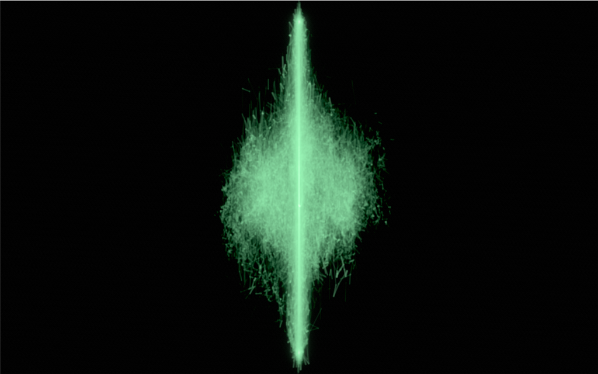
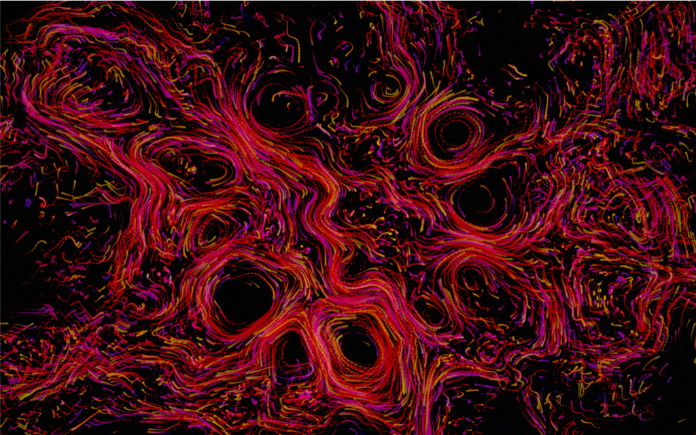
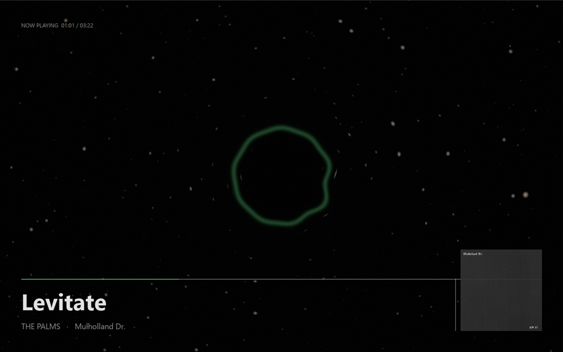
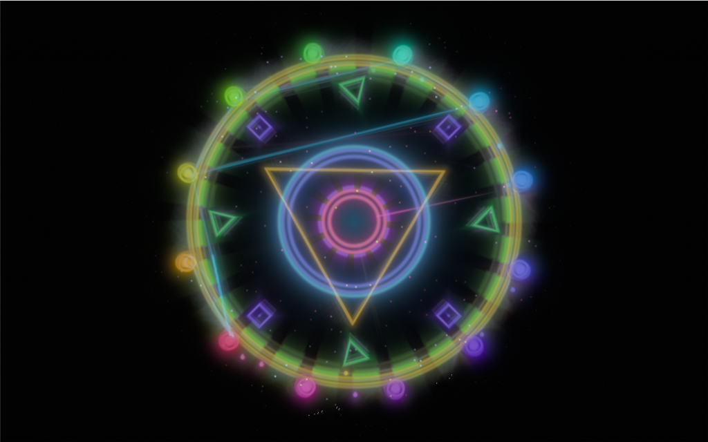
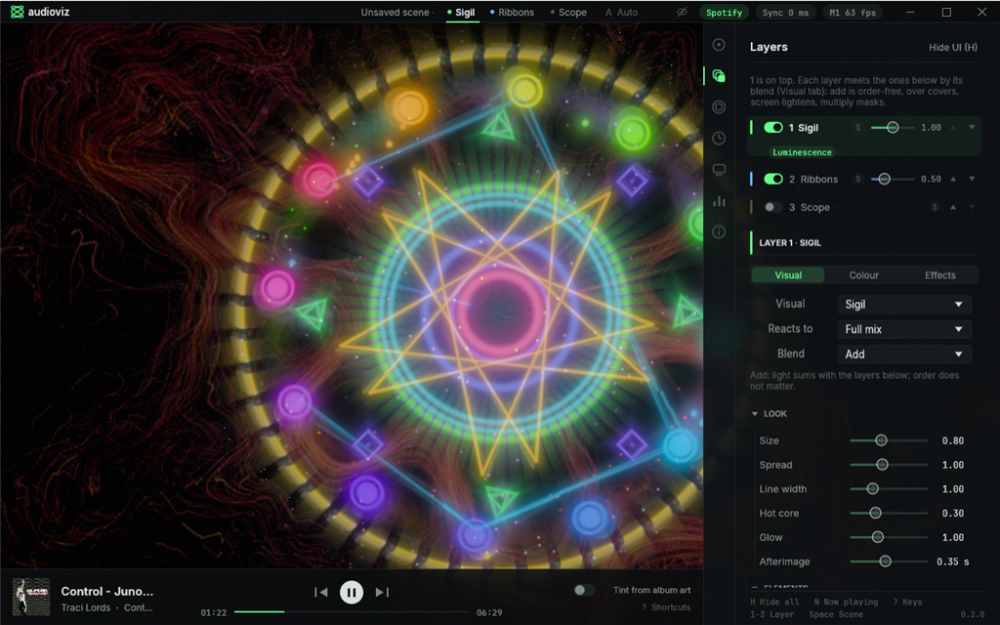

# audioviz

A spacey, line-based music visualizer for whatever Windows is playing, Spotify first. Native Rust + wgpu. Not a MilkDrop clone.

| Phosphor scope | Flow-field ribbons | Black hole |
|---|---|---|
|  |  |  |

| Kaleidoscope | Sigil | Settings panel |
|---|---|---|
|  |  |  |

Five visuals, layered three at a time into scenes: a phosphor XY oscilloscope of the real stereo signal, chroma-steered flow-field ribbons (GPU compute), a ray-marched black hole (lensed accretion disk, point stars), a kaleidoscope of the album art or your own photos, and the sigil, a neon sacred-geometry glyph that redraws itself for every track. Each layer runs a chain of music-driven modifiers and takes a colour palette. What is playing lives on the transport strip, fed by the Windows now-playing metadata. Per-process Spotify loopback with auto-reconnect, full real-time analysis (bands, loudness, onsets, predictive beat clock, chroma), bloom and auto exposure with a film or neon look, frame cap, monitor selection, and an optional auto director that changes scenes on track changes, drops and quiet passages.

## Install (Windows 10 2004+ / 11, DirectX 12 or Vulkan GPU)

- **Installer:** download `audioviz-<version>-setup.exe` from the [latest release](https://github.com/gregodouglas/audioviz/releases/latest). Installs per-user (no admin prompt) into `%LOCALAPPDATA%\Programs\audioviz`, adds a Start Menu shortcut, and optionally starts when you sign in.
- **Portable:** download `audioviz-<version>-portable-win64.zip`, unzip anywhere, run `audioviz.exe`.

**SmartScreen:** releases are not yet code-signed, so Windows shows "Windows protected your PC" the first time. Click *More info* → *Run anyway*, or verify the file against `SHA256SUMS.txt` on the release page first. Signing is planned; `PRIVACY.md` tracks the status.

Start Spotify, play something, start audioviz. If Spotify is not running the app visualizes the default output device instead and says so on screen.

## Use

The window is frameless. Move the mouse and a thin bar appears at the top (scene pips, status chips, window controls) with a transport strip at the bottom (album art, previous / play-pause / next, progress, tint from album art). Both hide after three seconds of mouse rest and in fullscreen. On first run a short welcome sheet asks for the monitor, offers the tap calibration and lets you pick a scene.

**Scenes, layers, visuals.** The five *visuals* (phosphor scope, flow-field ribbons, black hole, kaleidoscope: album art or your own photos behind the mirrors, and the sigil: a neon sacred-geometry glyph whose rings breathe with the bands, rays strike on onsets at the pitch class, orbs light with the chord, and which rebuilds itself on every track) are the raw material. A *layer* is one instance of a visual with its own controls, opacity, audio band and blend mode (add, or over / screen / multiply so a higher layer covers, lightens or masks the ones beneath; layer 1 is on top), and the same visual can be used more than once. A *scene* is a mix of up to three layers plus post settings and tint, saved by name; Scope, Ribbons, Starfield, Deep field, Night, Party, Studio, Kaleidoscope and Sigil come built in, and your own are JSON files in `%APPDATA%\audioviz\scenes\`. Each layer can react to the full mix or to one band (sub, bass, low mid, mid, presence, air, or a custom range): a scope layer set to bass draws only the bass waveform. Each layer also runs an ordered chain of *modifiers* over its picture: kaleidoscope mirrors, fractal recursion, luminescent afterglow, feedback echo, polar wrap, ripples, edges, chroma split and masks, every one of them moved by the music. Each layer can also take a colour palette (techno, neon, rave, 80s pop, galaxy and more, or your own stops): the ribbons spread a chord across it, the black hole's disk runs along it, and the palette modifier recolours anything else.

Press **Tab** for the settings panel: a docked sheet with an icon rail. Scenes; Layers (the stack of three slots, then an inspector for the one being edited with Visual, Colour and Effects tabs, each modifier opening in place); Picture (exposure, bloom, grain, scene tint); Sync (delay, calibration, which app to listen to, or the room through a microphone); Display (monitor diagram, frame cap, low power, reduce flashing, chrome options); Meters (developer); About (manual update check, diagnostics to paste into a bug report). Controls remember which groups you keep open, dim at their default, and reset on a double-click.

| Key | Action |
|---|---|
| Tab | Settings panel |
| 1 / 2 / 3 | Layer to edit |
| Space | Next scene |
| A | Auto scene director |
| C | Audio-delay calibration: tap Space on the beat, Enter to apply |
| ? | All shortcuts |
| F11 | Fullscreen on the current monitor |
| Esc | Close a sheet, else quit |

The tray icon menu shows the window, switches scene, toggles the director, goes fullscreen on a chosen monitor, and quits. `audioviz --tray` starts hidden in the tray (what "start when I sign in" uses).

**On a TV (experimental).** Display › Cast to a TV opens the Windows cast panel (Win+K) for a Roku or any Miracast television; when the TV appears as a display, one click puts the visualizer fullscreen on it. Play Spotify on the PC rather than through Spotify Connect: the sound travels with the picture, so a soundbar wired to the TV gets it, and the visualizer keeps hearing the music.

Loopback captures audio before it reaches your ears, so the visuals lead the sound by your output latency (wired headphones ~10-40 ms, Bluetooth 100-250 ms). Press **C** and tap along for ten beats; the app measures the offset and offers to apply it.

**Reduce flashing** (Display) is on by default: it caps how fast the picture may brighten between frames, for photosensitive viewers. Turn it off or raise the allowed rise if you want harder strobes.

Settings live in `%APPDATA%\audioviz\settings.json` (plain JSON; delete it to reset); scenes you save in `%APPDATA%\audioviz\scenes\`. `audioviz --version` prints the version; `audioviz --set key=value` changes a setting before starting.

## Privacy and trust

No telemetry, no accounts, no network on its own. The one connection the app can make is the **Check for updates** button in About, when you press it: one request to GitHub's releases endpoint through the Windows HTTP stack, nothing sent but the request. `PRIVACY.md` lists exactly what the app touches and how to verify this yourself (`cargo deny` bans every Rust HTTP/TLS/socket crate and CI enforces it). `SECURITY.md` says how to report a problem.

Fonts: [Inter](https://rsms.me/inter/) and [JetBrains Mono](https://www.jetbrains.com/lp/mono/), bundled under the SIL Open Font License (`assets/fonts/`). Direct dependencies (all MIT/Apache-2.0 or similar; `cargo deny check licenses` enforces the allow-list): `wgpu`, `winit`, `egui` + `egui-wgpu` + `egui-winit`, `wasapi`, `windows`, `sysinfo`, `realfft`, `image`, `glam`, `bytemuck`, `crossbeam-channel`, `serde` + `serde_json`, `dirs`, `tracing` + `tracing-subscriber`, `anyhow`, `pollster`. The icon generator (`xtask`) additionally uses `resvg` and `ico` and is not part of the shipped binary.

## Build from source

```
cargo build --release -p audioviz        # target/release/audioviz.exe, no console window
cargo run -p audioviz                    # debug build: console logs + WGSL hot reload (F5)
cargo test --workspace
cargo xtask icon                         # regenerate assets/icon.{svg,png,ico}
scripts/release.ps1                      # installer + portable zip + checksums + winget manifests → dist/
```

Dev overrides: `AUDIOVIZ_SCENE=n`, `AUDIOVIZ_SIZE=WxH`, `AUDIOVIZ_DEFAULTS=1` (ignore the settings file), `AUDIOVIZ_SETTINGS='{...}'` (merge JSON into the settings for one run), `AUDIOVIZ_PANEL=<section>`, `RUST_LOG=audioviz=debug` for a per-second stats line. `scripts/snapshot.ps1` runs the app for N seconds and captures the window to `target/snapshot.png`.

Releases: bump `version` in `Cargo.toml`, commit, `git tag vX.Y.Z && git push --tags`. The release workflow builds and tests on Windows and macOS, packages everything with `scripts/release.ps1`, and opens a draft GitHub release with the notes from `docs/release-notes-template.md`.

## Status and docs

**v0.1.0 released 2026-10-17** (Phase 5, ship-ability); **0.3.0 is on `main`** (visuals round: Waves, Crystal, Wheel, Lantern; Halftone, Warp, Scanlines, Mirror; effects director; presets), not yet tagged. Phase briefs: `docs/phase1-spike.md` (build/run, latency protocol), `docs/phase2-analysis.md`, `docs/phase3-polish.md`, `docs/phase4-scenes.md`, `docs/phase5-ship.md`, `docs/phase6-ui.md` (UI refresh, composition model, visuals, colour; progress log at the top), `docs/phase7-controls.md` (the panel's inspector model). The words (Space, Scene, Layer, Visual, Effect, Picture) and the two directors: `docs/model.md`. Shipped presets and scenes are the JSON files under `assets/presets/` and `assets/scenes/`, and every visual is a folder under `assets/visuals/` (a `visual.json` and a `visual.wgsl`; none is compiled in since the Sigil's port, and your own sit beside them: `docs/building-visuals.md`); the app writes them into `%APPDATA%\audioviz\` on first run and reads only that folder from then on, updating a copy you never edited when a newer version ships (`assets/factory-history.txt` fingerprints every version that shipped). What is still open: `docs/ROADMAP.md`. Research in `docs/research/00-synthesis.md`; decisions in `docs/decisions/`. macOS follows the UI refresh; the core already builds there in CI with null audio/metadata backends.

Ideas borrowed from other visualizers are credited in [`docs/INSPIRATION.md`](docs/INSPIRATION.md).

## Layout

- `crates/audio` — `AudioSource` trait + WASAPI per-process / endpoint loopback and microphone backend
- `crates/analysis` — `Analyzer` → `FeatureFrame` (bands, loudness, onsets, beat clock, chroma)
- `crates/metadata` — `MetadataSource` trait + Windows SMTC backend (now playing + art)
- `crates/app` — winit + wgpu app: `scene.rs` / `director.rs` / `post.rs`, `visuals.rs` (the registry) and `shader_visual.rs` (visuals loaded from `assets/visuals/` and your own folder), `color.rs` palettes, egui chrome / panel / strip in `chrome.rs`, `panel.rs`, `strip.rs`, sheets in `overlays.rs`, WGSL in `shaders/`, `build.rs` embeds the icon and version resource
- `xtask` — `cargo xtask icon`
- `installer/audioviz.iss` — Inno Setup script; `scripts/release.ps1` — packaging; `winget/` — manifest templates for a future winget submission (not submitted)
- `.github/workflows/` — `ci.yml` (build + test on Windows and macOS, `cargo deny`), `release.yml` (tag → draft release)
- `docs/research/` — research briefs (`00-synthesis.md` first)

## License

MIT, © 2026 Gregory Douglas.
