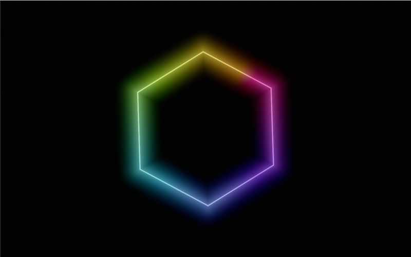
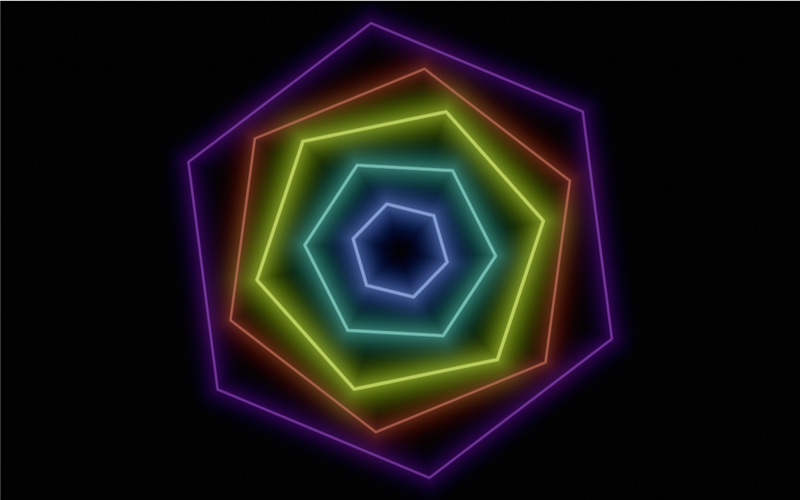
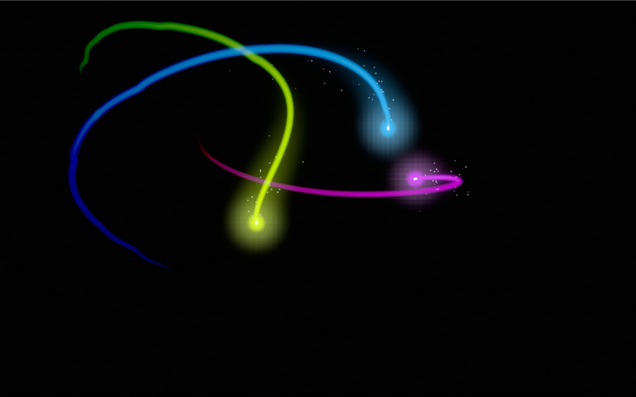

# Building visuals

This guide is for someone who has written a little shader code (a Shadertoy sketch, a GLSL effect) but has never opened this codebase. It walks you from an empty folder to a visual that reacts to music, runs cheaply and can be shared. The reference for every field and function is [`docs/visuals.md`](visuals.md); this guide explains how to use them.

A **visual** draws one layer's picture. Everything else about a layer belongs to the engine and applies to your visual without any work from you: the band it reacts to, its tint and palette, blend and opacity, the chain of effects and its director, presets, scenes, levelling and the Performance timings (see [`docs/model.md`](model.md) for the words). Your job is only the picture.

## What a visual is

A folder with two files:

```
%APPDATA%\audioviz\visuals\
    my-visual\
        visual.json    the manifest: id, names, credit, up to 16 controls
        visual.wgsl    one WGSL function: fn shade(uv: vec2<f32>) -> vec3<f32>
```

(`%APPDATA%` is `C:\Users\<you>\AppData\Roaming`; paste `%APPDATA%\audioviz\visuals` into Explorer's address bar.) The folder name is yours to choose; the `id` inside `visual.json` is what matters. Other files in the folder are ignored, so a `LICENSE` or a `README` can sit beside them.

The app reads the folder when it starts and lists each visual in the Visual tab's list after the built-in ones, marked "Loaded". A folder added while it runs appears in the list within a few seconds. Saving either file reloads the visual while it runs.

The quickest start is the Visual tab's **Your own visuals** group: type a name and press **New visual**. It copies a small starter (a ring that swells with the bass) into a new folder, puts it on the layer you are editing and opens the folder in Explorer; edit `visual.wgsl`, save, and watch it change. The same group has **Open visuals folder**, **Restore factory visuals** (writes the shipped visuals back over your changes to them; your own folders are untouched) and a link to this guide. A loaded visual's own controls end with **Open its folder**.

`shade` is called once for every pixel of the layer, every frame. It returns the colour of that pixel as linear light. That is the whole contract: no vertex buffers, no render passes, no Rust.

The visuals that ship with the app live in the repo under `assets/visuals/` and are copied into your folder on first run. Four of them are worth reading next to this guide: **Polygon**, **Pulse** and **Comet** (the three worked examples below) and **Eclipse** (a full visual, ported from a compiled-in one).

## visual.json, field by field

```json
{
  "id": "polygon",
  "name": "Polygon",
  "short": "Polygon",
  "summary": "One glowing regular polygon, turning slowly, coloured round its outline by the palette.",
  "credit": "Example 1 of docs/building-visuals.md.",
  "hint": "A still shape: the starting point of the Building visuals guide.",
  "feedback": false,
  "params": [
    { "id": "sides", "label": "Sides", "type": "integer", "group": "Shape", "min": 3, "max": 12, "default": 6 },
    { "id": "spin", "label": "Spin", "group": "Shape", "min": -0.5, "max": 0.5, "default": 0.02, "help": "Turns per second." },
    { "id": "reach", "label": "Glow reach", "group": "Light", "min": 0.01, "max": 0.3, "default": 0.04, "log": true, "help": "How far the glow spreads." }
  ]
}
```

| Field | Required | What it does |
|---|---|---|
| `id` | yes | Lowercase letters, digits, `-` and `_`. Saved layers, scene files and the presets folder point at it, so **never change it once anyone uses your visual**. If a built-in or another folder already has the id, your folder is skipped (and a warning goes to the log). |
| `name` | yes | The name in the Visual list, capitalised like the built-ins ("Spectrum wheel", "Black hole"), no underscores. |
| `short` | no | A short name for the bar, the layer stack and breadcrumbs. Defaults to `name`. |
| `summary` | no | One line, shown when hovering the visual in the list and behind the "?" beside it. |
| `credit` | no | Who the idea or code comes from, and the licence. Shown at the foot of the Visual tab. |
| `hint` | no | A longer explanation at the foot of the Visual tab: what the controls do, which part of the music drives what. |
| `feedback` | no | `true` keeps your last frame so `prev(uv)` can read it (example 3). Default `false`. |
| `triangles` | no | How many triangles `fn vertex` draws (up to 1048576); required with `fn vertex`, and only then. See "Drawing triangles" below. |
| `items` | no | How many values your `prepare` step computes each frame (up to 4096); required when `visual.wgsl` has `fn prepare`, and only then. See "Once a frame: prepare" below. |
| `line` | no | How many points your line has (2 to 65536); required when `visual.wgsl` has `fn point`, and only then. See "Drawing a line" below. |
| `line_count` | no | The id of a number control that says how many of the line's points to draw (Spiral's "Points"). |
| `line_style` | no | `"line"` (the default) or `"beam"`: a phosphor beam with a Gaussian edge (`width` is its sigma in pixels) whose brightness falls with each segment's length. |
| `band_waveform` | no | `true`: a layer band filters the waveform itself, not only the levels and spectrum. |
| `params` | no | Up to 16 controls (below). |

Each entry in `params`:

| Field | What it does |
|---|---|
| `id` | The name in your shader (`params().sides`) and in saved files. A lowercase identifier (`a-z`, `0-9`, `_`), not a WGSL keyword; a word WGSL only reserves (`smooth`, `filter`, `target`...) is allowed and reads `P.smooth_` in the shader. Like the visual's id, keep it stable: renaming it resets everyone's saved value. |
| `label` | The control's label. Sentence case ("Line width"), no underscores. |
| `type` | `slider` (the default), `integer`, `toggle` or `choice`. |
| `group` | A heading. Controls with the same group sit together, groups in order of first use. Without groups everything lands under "Controls". |
| `min`, `max` | The range of a slider or integer (default 0 to 1). |
| `default` | A number; `true`/`false` for a toggle; the option's name for a choice (`"knot"`). Double-clicking a control resets it here. |
| `options` | A choice's options, as shown ("Circle", "Eight", "Knot"). Three or fewer show as a segmented control, more as a dropdown. The shader sees the index: 0, 1, 2... |
| `values` | What a choice saves for each option, when that should differ from the option's name in lowercase (one per option). |
| `log` | A logarithmic slider, for gains and times that span decades. |
| `unit` | Shown after the value: `"px"`, `"s"`, `"x"`. Keep it to a couple of characters (the value column is narrow); say more in `help`. |
| `help` | The control's tooltip. |

Every control is an `f32` in the shader: a toggle is 0 or 1, a choice is its option's index, an integer is a whole number. Values are saved in the layer as `"polygon": { "sides": 6, "spin": 0.02, ... }`, so presets and scenes hold them like any built-in's.

## visual.wgsl and the API

The engine builds your shader from three parts: the API (`crates/app/shaders/visual_api.wgsl`, with a small shared prelude in front), a `Params` struct generated from your manifest, and your file. Your file needs one function:

```wgsl
fn shade(uv: vec2<f32>) -> vec3<f32> {
    let P = params();          // your controls by name: P.sides, P.spin
    let p = centred(uv);       // centred coordinates, short side -1..1, y up
    return colour(0.5) * smoothstep(0.5, 0.49, length(p));   // a disc in the layer's colour
}
```

Add any helper functions and constants you like above it. Names the API already uses (below, plus `FsIn`, `fullscreen_vertex`, `vs_main`, `fs_main`, `cs_main`, `cs_line`, `V`, `Params`, `ITEMS`, `LINE_POINTS`, `LinePoint`, `MeshVertex`, `MeshFragment`, `MeshOut`, `vs_mesh`, `fs_mesh`) cannot be reused.

### Coordinates

- `uv` is 0..1 across the layer, **(0, 0) at the top left, y down**: the texture convention.
- `centred(uv)` gives the coordinates you usually want: the origin in the middle, **y up**, and the **short side's half-extent is 1**. On a 2560x1440 window y runs -1..1 and x runs -1.78..1.78; on a portrait monitor x runs -1..1 and y is the long one. A circle of radius 0.9 always fits.
- `uncentred(p)` turns centred coordinates back into `uv`, for reading `prev()` at a moved place.
- `pixel()` is the size of one pixel in centred units (2 / the short side in pixels). Use it for antialiasing and for widths given in pixels: `0.5 * P.width * pixel()`.
- `rotate(p, a)` turns a point by `a` radians counter-clockwise. To turn a shape, turn the plane the other way: `rotate(p, -angle)`.

### Colour

What `shade` returns is **linear HDR light**: 1.0 is "white", values above it are fine and simply brighter (the Picture's tonemapper rolls them off, bloom spreads them). Negative values are clamped to 0, and a NaN pixel is dropped (it would otherwise black out the whole layer's levelling, see below).

`colour(t)` is how a visual takes the layer's colours: the layer's **palette** at position `t` (0..1, wrapping) mixed over its **tint** by the palette's amount. With no palette chosen it returns the tint. The palette also moves by itself (its cycle, and its reaction to the music), so `colour(0.3)` drifts over time without you asking. Give each element its own `t` (an angle, a ring index, a band position) and a palette spreads across your picture; pick one `t` and the visual is one colour. Prefer `colour()` over hard-coded colours: then every palette, tint, "album art" tint and the effects that recolour (Palette, Colorify) carry through your visual, which is a rule of this app.

Raw access, if you need it: `V.tint.rgb`, `V.palette_mix` (0 = no palette), `V.palette_shift`, and the baked table `V.palette[0..31].rgb`.

### What happens after `shade`

Your picture is not shown as is. Per layer, in order:

1. **The effect chain** (Kaleidoscope, Glow, Mirror, Halftone and the rest), each a pass over your picture.
2. **Levelling** (when the Picture's Auto exposure is on, the default): the layer is scaled so the average brightness of its *lit* part lands on a fixed target, eased over about 1.5 s. So absolute brightness hardly matters: a visual drawn ten times brighter looks the same a second later. What matters is contrast within your picture, and what counts as "lit": any pixel above about 1e-6. **End your glows at exactly zero** (`max(exp(-d / k) - 0.002, 0.0)`, as the examples do); a tail that never ends makes the whole frame count as lit, the average drops, and your bright parts are pushed up to compensate.
3. **Blend** into the scene with the layer's opacity (Add, Over, Screen or Multiply; slot 1 on top).
4. **The Picture**, once for the whole scene: exposure, bloom, grain, saturation and the tonemapping look (Film rolls bright colours towards white, Neon keeps their hue).

### The music

All of these are in the `V` struct or are functions. The values respect the layer's **Reacts to** band: if the layer listens to 20-400 Hz, the energy, onsets and spectrum are of that band.

| | Range | What it is |
|---|---|---|
| `V.time` | seconds | Since the app started. For motion that should not care about the music. |
| `V.dt` | seconds | This frame's length (0.004 at 240 fps, 0.017 at 60). Use it for anything that accumulates, so a visual looks the same at every frame rate. |
| `V.resolution` | pixels | The layer's size. |
| `V.flow` | seconds | **A music clock**: advances 0.5 s per second in silence up to about 1.7 s per second when loud (by `V.dt * (0.5 + 0.5 * V.energy)` each frame). Use it in place of `V.time` for motion that should speed up with the music. |
| `V.energy` | 0..2.5, ~1 | The overall level against its own recent average: 1 is "as loud as lately", above is a build or a drop. |
| `V.bass`, `V.mid`, `V.treble` | ~0..3, ~1 | The same for 30-200 Hz, 200-2000 Hz and 2-16 kHz. |
| `V.swell` | 0..~2 | Bass above its average plus low onsets, fast attack and slow release: a ready-made "breathing" amount for sizes and pushes. |
| `V.beat` | 0..1 | The beat pulse: jumps to 1 on each beat and decays; scaled by the tracker's confidence, so it fades out in music without a clear beat. |
| `V.beat_phase` | 0..1 | Where we are within the current beat. |
| `V.beat_count` | count | Beats since start; `V.beat_count % 4.0` counts within a bar of four. |
| `V.bpm` | ~60..200 | The tracked tempo. |
| `V.onset` | 0..1 | A pulse on any onset (a hit, a note start), decaying. |
| `V.onsets` | 0..1 each | Onset pulses for low, mid, high and all: `V.onsets.x` is kicks, `.z` is hats. |
| `V.key` | 0..11 | The dominant pitch class, C = 0. |
| `V.quiet` | 0 or 1 | 1 during a quiet passage (a breakdown, the gap between tracks). |
| `band(i)` | ~0..1 | Band `i` of 32, log-spaced from 30 Hz (0) to 16 kHz (31), each auto-gained, smoothed with a 30 ms attack and 200 ms release. |
| `band_raw(i)` | ~0..1 | The same without smoothing: jumpier, better for flashes. |
| `band_at(t)` | ~0..1 | The smoothed spectrum at `t` 0..1 (low to high), interpolated between bands. The easy way to map a position to a frequency. |
| `chroma(i)` | 0..1 | Pitch class `i` (C = 0, C# = 1 ... B = 11), normalised so the loudest class is 1. |
| `wave(t)` | ~-1..1 | The last 1024 samples (`t` 0 oldest, 1 newest) as (left, right), auto-gained. |
| `wave_mono(t)` | ~-1..1 | Their average. |
| `sample(i)` | ~-1..1 | Sample `i` of the last 4096, newest first, (left, right), auto-gained: for walking the waveform sample by sample. |
| `V.track` | 0..1 | A hash of the playing track: a seed for anything that should be the same each time a song plays and change with the next. |
| `V.instance` | 0..1 | Random per layer: two layers of the same visual start from different seeds. |
| `V.wave_new` | count | How many of `sample()`'s newest samples arrived since last frame: a trace that draws exactly these (the scope) never repeats or skips one. |
| `V.auto_gain`, `V.sample_rate` | | The gain already applied to the waveform (divide by it to undo), and samples per second. |
| `prev(uv)` | colour | Your own last frame, before effects (with `"feedback": true`; black otherwise). |
| `picture(uv)`, `picture_prev(uv)` | colour | With `"pictures"` in the manifest: the current picture (album art or a photo from the photos folder) and the one before it, 0..1 across, y down, mirrored outside. `V.picture_fade` (0..1, eased) is how far the new one has replaced the old; `V.picture_aspect`, `V.picture_prev_aspect` are width over height; `V.picture_count` goes up by one per new picture. |
| `art(uv)` | colour | The playing track's album art at `uv` (0..1, y down, square, linear colour); black when there is none. It changes with the track. To map it into centred coordinates: `art(vec2<f32>(p.x, -p.y) * 0.5 + 0.5)`. |
| `V.has_art` | 0 or 1 | 1 when the track has album art. |
| `item(i)`, `ITEMS` | vec4 | Item `i` from your `prepare` step, and how many there are (`items` in the manifest). In `shade` this frame's value; inside `prepare` last frame's. |
| `param(i)` | | Control `i` by position, for loops over controls. Usually `params()` is clearer. |

Also available: `TAU` (2π), `hash21(p)` and `hash22(p)` (a pseudo-random 0..1 number or pair from a position), `noise(p)` (smooth value noise 0..1, one feature per unit), and `ign(p)` (interleaved gradient noise from a pixel position, for dithering).

## Three worked examples

Each is a real folder in `assets/visuals/` and ships with the app, so you can pick it in the Visual list, open its files and change them while it runs. The snapshots are at the defaults with the Neon palette.

### 1. A still shape: Polygon



The smallest useful visual: a distance function, an antialiased line, a glow and the palette. It ignores the music entirely (the layer's effects and director can still move it).

```wgsl
const PI: f32 = 3.14159265;

// Signed distance to a regular n-gon with circumradius r, a vertex at the
// top (negative inside). After Inigo Quilez's sdRegularPolygon (MIT).
fn polygon(p: vec2<f32>, r: f32, n: f32) -> f32 {
    let an = PI / n;
    let a = atan2(p.x, p.y);
    let b = a - 2.0 * an * floor(a / (2.0 * an)) - an;
    var q = length(p) * vec2<f32>(cos(b), abs(sin(b)));
    q -= r * vec2<f32>(cos(an), sin(an));
    q.y += clamp(-q.y, 0.0, r * sin(an));
    return length(q) * sign(q.x);
}

fn shade(uv: vec2<f32>) -> vec3<f32> {
    let P = params();
    let p = rotate(centred(uv), -V.time * P.spin * TAU);
    let d = abs(polygon(p, P.radius, P.sides));

    let half = 0.5 * P.width * pixel();
    let line = clamp((half - d) / pixel() + 0.5, 0.0, 1.0);
    let glow = P.glow * max(exp(-d / P.reach) - 0.002, 0.0);

    let t = atan2(p.x, p.y) / TAU + 0.5;
    return colour(t) * (2.0 * line + glow);
}
```

What to take from it:

- **Distance, then light.** Most visuals here are "how far is this pixel from the thing", then a function that turns distance into brightness. `abs(d)` turns a filled shape's distance into its outline's.
- **Antialiasing.** `clamp((half - d) / pixel() + 0.5, 0, 1)` is 1 inside the line, 0 outside and ramps over exactly one pixel, at any window size.
- **The glow ends.** The `- 0.002` makes the tail reach zero about six `reach` lengths out; without it the levelling sees the whole frame as lit (above).
- **Palette by angle.** `t` runs once round the shape, so the palette wraps it, and it moves with the palette's cycle.
- **Units a person can reason about.** `width` is in pixels and `spin` in turns per second; the shader converts. Controls a person can reason about are worth the line of arithmetic.

### 2. Reacting to the music: Pulse



Polygon's shape, repeated: one ring per slice of the spectrum, bass innermost. Each ring swells and brightens with its own band, the beat kicks them all outward, onsets flash them, and neighbouring rings turn against each other on the music clock.

```wgsl
fn shade(uv: vec2<f32>) -> vec3<f32> {
    let P = params();
    let p = centred(uv);
    let n = u32(P.rings);
    let kick = 1.0 + 0.08 * P.kick * V.beat;
    let flash = 1.0 + 2.0 * P.flash * V.onset;
    var col = vec3<f32>(0.0);
    for (var i = 0u; i < n; i++) {
        let t = (f32(i) + 0.5) / f32(n);
        let level = clamp(band_at(t) * P.gain, 0.0, 3.0);
        let r = P.radius * (f32(i) + 1.0) / f32(n) * (1.0 + 0.12 * level) * kick;
        let dir = select(-1.0, 1.0, i % 2u == 0u);
        let q = rotate(p, dir * V.flow * P.twist + f32(i) * 0.3);
        let d = abs(polygon(q, r, P.sides));
        let half = 0.5 * P.width * pixel() * (1.0 + level);
        let line = clamp((half - d) / pixel() + 0.5, 0.0, 1.0);
        let glow = P.glow * max(exp(-d / 0.04) - 0.002, 0.0);
        let bright = (0.15 + level * level) * flash;
        col += colour(t) * (2.0 * line + glow) * bright;
    }
    return col;
}
```

(`polygon` as in example 1; each folder is self-contained, so helpers are copied, not shared.)

What to take from it:

- **One position, three uses.** `t` picks the ring's band (`band_at(t)`), its colour (`colour(t)`), and its place. Tying space, frequency and colour together is what makes a picture read as the music.
- **Pulses, not values, for events.** `V.beat` and `V.onset` jump and decay by themselves; multiply by them and the decay comes free. Keep the multiplier modest (`0.08 * kick`): the beat is the strongest signal there is.
- **Squared level.** `level * level` keeps quiet bands faint and lets loud ones burn; a linear level looks flat. Add a floor (`0.15 +`) so the structure never vanishes completely.
- **`V.flow` for motion.** The rings turn faster when the music is loud, without anything jumping.
- **The loop runs per pixel.** Eight rings is fine (0.44 ms at five). See the budget below before writing a loop of sixty-four.

### 3. Feedback: Comet



Heads moving on Lissajous paths with the music clock, leaving trails that drift outward, turn and fade. The trails are not stored anywhere: with `"feedback": true`, `prev(uv)` returns last frame's picture, and each frame starts from it, slightly moved and faded.

```wgsl
fn shade(uv: vec2<f32>) -> vec3<f32> {
    let P = params();
    let p = centred(uv);

    // Last frame, read a little nearer the centre (so it drifts outward) and turned.
    let q = rotate(p * (1.0 - P.drift * V.dt), -P.swirl * V.dt);
    let quv = uncentred(q);
    let inside = all(quv >= vec2<f32>(0.0)) && all(quv <= vec2<f32>(1.0));
    let keep = exp(-V.dt / P.trail);
    var col = select(vec3<f32>(0.0), max(prev(quv) * keep - 0.02 * V.dt, vec3<f32>(0.0)), inside);

    // Draw each head as the segment from last frame's place to this one's.
    let s1 = V.flow * P.speed * 0.25;
    let s0 = (V.flow - V.dt * (0.5 + 0.5 * V.energy)) * P.speed * 0.25;
    let radius = P.radius * (1.0 + 0.15 * V.swell);
    let n = u32(P.heads);
    for (var i = 0u; i < n; i++) {
        let fi = f32(i);
        let d = segment(p, path(s0, fi, P.heads, P.figure, radius), path(s1, fi, P.heads, P.figure, radius));
        let half = 0.5 * P.size * pixel() * (1.0 + 0.5 * V.beat);
        let core = clamp((half - d) / pixel() + 0.5, 0.0, 1.0);
        let c = colour(fi / P.heads + V.flow * 0.02) * (3.0 * core + 0.5 * max(exp(-d / (4.0 * half)) - 0.01, 0.0));
        col = max(col, c);
    }
    return col;
}
```

(`segment` is the distance to a line segment and `path` a Lissajous point; both are in the folder.)

What to take from it:

- **Move the old frame by reading from elsewhere.** To push the trail outward, read from slightly *inside* (`p * (1 - drift * dt)`); to turn it clockwise, read anticlockwise. Read outside the frame and you get the edge pixels smeared in, hence the `inside` test.
- **Fade by time, not by frame.** `exp(-V.dt / P.trail)` fades by the same amount per second at 60 and at 240 fps. A fixed `0.95` per frame would make trails four times shorter on a fast monitor.
- **Make the fade reach zero.** The frame is stored in half floats: a value that is only ever multiplied by 0.99 gets stuck a little above zero, and the whole screen stays faintly lit forever. Subtract a little as well (`- 0.02 * V.dt`).
- **Bound it.** Combine with `max`, not `+`: a head resting in one place would otherwise add up without limit.
- **Close the gaps.** A fast head jumps several pixels a frame and would leave a dotted trail; drawing the segment from where it was to where it is gives a solid line. `V.flow` advanced by `V.dt * (0.5 + 0.5 * V.energy)`, so last frame's clock is known exactly.
- **Choices are indices.** `P.figure` is 0, 1 or 2 for Circle, Eight and Knot.

`prev` is your visual's own output before the layer's effects. For echoes of the *finished* layer (after Kaleidoscope, say), use the Feedback effect instead; it works on any visual.

## Once a frame: prepare

Anything in `shade` that does not depend on the pixel (a dot's band level, its position, a `pow` of a level) is worked out again for every one of the 3.7 million pixels. A **prepare step** works such values out once a frame instead. Add a function to `visual.wgsl`:

```wgsl
fn prepare(i: u32) -> vec4<f32> { ... }
```

and say in `visual.json` how many items it makes: `"items": 128` (up to 262144). The engine calls `prepare(i)` once for each `i` below that number at the start of every frame (on the GPU, all at once), stores the four numbers each returns, and `shade` reads them with `item(i)`. `prepare` sees everything `shade` does: `V`, `params()`, `band_at`, `colour`. What it cannot do is depend on a pixel: it has no `uv`.

Eclipse uses it for its dots. Each dot needs a position, a size, a level and a colour: five or more numbers, so each dot takes two items:

```wgsl
// Dot d is items 2d (centre x, centre y, size, level) and 2d + 1 (colour).
fn prepare(i: u32) -> vec4<f32> {
    let P = params();
    let n = dot_count();
    let d = i / 2u;
    if (d >= n) {
        return vec4<f32>(0.0);
    }
    let mirror = P.mirror > 0.5;
    if (i % 2u == 1u) {
        return vec4<f32>(ring_colour((f32(d) + 0.5) / f32(n), mirror, P.range), 0.0);
    }
    // ... the band level, pow, angle and size, as shade() used to do per pixel ...
    return vec4<f32>(cos(a) * rr, sin(a) * rr, s, lvl);
}

fn shade(uv: vec2<f32>) -> vec3<f32> {
    // ...
    for (var d = 0u; d < n; d++) {
        let dot_at = item(2u * d);
        let dist = length(p - dot_at.xy);
        // ... the dot's core and halo from dist, dot_at.z (size) and dot_at.w (level) ...
        col += item(2u * d + 1u).rgb * (core * bright + halo * bright * 0.6);
    }
    // ...
}
```

The loop in `shade` is still there, but each turn is now a subtraction, a length and a division instead of a spectrum lookup, a `pow`, a `sin` and a `cos`: 1.1 ms became 0.69 at 16 dots, and 4.5 became 2.7 at 64, faster than when Eclipse was compiled into the app.

**Memory.** Inside `prepare`, `item(i)` returns *last frame's* value of item `i` (zero on the first frame). So a prepare step can keep state from frame to frame: smooth a level, hold a peak, integrate a position, count beats. A peak that falls slowly:

```wgsl
fn prepare(i: u32) -> vec4<f32> {
    let level = band_at(f32(i) / f32(ITEMS));
    let peak = max(level, item(i).y - 0.5 * V.dt);   // last frame's peak, falling 0.5 per second
    return vec4<f32>(level, peak, 0.0, 0.0);
}
```

Use `V.dt` for anything that accumulates, so it runs at the same speed at every frame rate. Items run in parallel, so one item cannot see another's value from *this* frame; when many items depend on one shared decision (Loop's ring clock), have each of them work it out from last frame's state the same way. And keep each item's work modest: a few thousand reads in one item can make the shader take the driver a long time to compile (Loop's first version did not start). Items are not saved: they start from zero when the app starts or the visual is picked again.

## Drawing a line

Some pictures are one long line: a spiral, a Lissajous figure, a waveform. Drawing a line in `shade` means measuring each pixel's distance to every segment, which is the loop-per-pixel trap at its worst. Instead, say in `visual.json` how many points the line has (`"line": 6000`) and give them from a function:

```wgsl
fn point(i: u32) -> LinePoint {
    let u = f32(i) / f32(LINE_POINTS - 1u);   // 0 at the first point, 1 at the last
    var q: LinePoint;
    q.pos = vec2<f32>(cos(u * TAU), sin(u * TAU)) * 0.8;   // centred coordinates
    q.width = 2.0;                                       // pixels; 0 breaks the line here
    q.colour = colour(u);                                // linear light
    return q;
}
```

The engine calls `point(i)` once for each point every frame (after `prepare`, so it can read this frame's items), then draws the segments between consecutive points as soft, round-capped strokes, added over whatever `shade` returned. If the line is all there is, leave `shade` out altogether: the engine then skips the full-screen pass, which at 2560x1440 is most of the cost of a line visual. Width and colour blend along each segment. A point with width 0 ends one stroke and the next point starts another, so one line can be many strokes. With `feedback`, the line is part of what `prev()` reads next frame, so trails work.

**Harmonograph** (`assets/visuals/harmonograph/`) is the example: a damped Lissajous figure of 6000 points whose two swings run at the interval between the music's two strongest pitch classes. Its `prepare` step finds the interval and glides toward it (state, in one item), and `point` reads that item. It costs 0.05 ms at 2560x1440. **Spiral** is another: its "Points" control is named in `"line_count"`, so only that many points are computed and drawn.

## Drawing triangles

For a surface, a solid or anything with a front and a back, give `"triangles": N` and a function for the corners:

```wgsl
fn vertex(i: u32) -> MeshVertex {
    var v: MeshVertex;
    v.pos = vec4<f32>(x, y, 0.0, 1.0);        // centred units; w > 1 for perspective
    v.colour = vec4<f32>(colour(0.3), 0.0);    // premultiplied: a = 0 adds light, a = 1 covers
    v.data = vec4<f32>(height, 0.0, 0.0, 0.0); // anything paint() wants per pixel
    return v;
}
```

Corners 3k, 3k + 1 and 3k + 2 make triangle k, and triangles are drawn in order, so draw far things first when near ones should cover them (the painter's way; there is no depth test). An optional `fn paint(f: MeshFragment) -> vec4<f32>` colours each pixel from the interpolated `f.colour` and `f.data` and its `f.pixel` position; `fwidth` and the other derivatives work there, which is how **Ripples** (`assets/visuals/ripples/`) draws contour lines one pixel wide at every distance. Triangles go over whatever `shade` returned, and the line goes over them; leave `shade` out when the triangles are the picture.

## A performance budget

`shade` runs for every pixel: 3.7 million at 2560x1440, 8.3 million at 4K, every frame. A line of code is cheap; a line inside a loop is that line times the loop count, times millions.

**Measure, do not guess.** Open the **Performance** section (the gauge on the rail, or click the "GPU n%" chip on the bar). "Where the GPU time goes" lists every layer's visual and effects in milliseconds, smoothed over a second; the Visual tab also shows your visual's own time next to its name. Measure at the size you will run at (for a portrait 1440x2560 monitor, a 2560x1440 window is the same pixel count), with music playing.

What a frame costs (release build, RTX 2070 Super, 2560x1440):

| | ms |
|---|---|
| The engine's floor for one layer: levelling and blend, composite, the Picture | ~0.6 |
| Polygon | 0.12 |
| Comet (three heads, feedback) | 0.24 |
| Pulse (five rings) | 0.44 |
| Spectrum wheel (64 wedges, state and colours in `prepare`) | 0.16 (compiled in, it was 0.18) |
| Harmonograph (a 6000-point line, no `shade`) | 0.05 |
| Spiral (1500 points, no `shade`) | 0.20 (compiled in, it was 0.26) |
| Eclipse (16 dots, a loop with a halo per dot, levels in `prepare`) | 0.69 |
| Eclipse at 64 dots | 2.7 |
| Eclipse at 16 and 64 dots before it had a `prepare` step | 1.1 and 4.5 |
| The heaviest visuals (Black hole, loaded since its port; Sigil) | ~4 |

The frame you have: 4.2 ms at 240 Hz, 6.9 at 144, 16.7 at 60, for everything: three layers, their effects, the Picture and the panel. The app's own goal is that a full scene runs on one ordinary PC. So **aim for 1 ms or less for a visual at 2560x1440**, treat 2 ms as heavy, and leave 3.5 ms to the two built-ins that earn it. Costs scale with pixels: double them for 4K.

**The loop-per-pixel trap.** Eclipse loops over its dots in every pixel: at 16 dots it costs 0.69 ms, at 64 it costs 2.7. A loop's cost is pixels × iterations × the work inside, and the work inside usually includes an `exp` or a `pow`. Ways out, from cheapest:

- **Cap the count in the manifest.** A slider that goes to 64 will be set to 64. Choose `max` for what you can afford.
- **Find the one that matters.** For things laid out on a grid or round a circle, compute which one this pixel is nearest (`round(angle / step)`) and evaluate it and its two neighbours, not all of them.
- **Skip early.** Test a cheap bound first (`if (d > reach) { continue; }`) before the expensive falloff.
- **Hoist.** Anything that does not depend on the pixel (a band level, a radius, a `sin` of the time) is the same for all 3.7 million pixels. Keep it outside loops, and when it is per item, move it into `prepare` (above): that took Eclipse from 1.1 to 0.69 ms.

Two smaller traps: transcendental functions (`exp`, `pow`, `atan2`, `sin`) cost several times a multiply-add, so keep them out of inner loops; and derivatives (`dpdx`, `fwidth`) are not allowed inside branches that depend on the pixel, so compute them first or use `pixel()` instead.

## Debugging

- **Hot reload.** Save `visual.wgsl` or `visual.json` and the visual reloads within half a second (a file changed while no layer used it is read when a layer next picks it). Manifest changes rebuild the panel too (new controls appear, with their defaults). The `id` stays the one the app started with until a restart.
- **Errors.** A shader that does not compile shows its error at the top of the Visual tab, with the position in your file ("visual.wgsl line 12, col 5"), while the last good version keeps drawing. If the very first version fails, the layer is black until you fix it. A broken `visual.json` at startup means the visual is skipped and not listed; the reason goes to the log (below). The full name list is checked: a control id that is a WGSL word, a duplicate, or a choice without options is refused with a message.
- **See the music.** Display › Developer › **Show meters** adds a Meters section with the beat, onsets, levels and spectrum live, so you can see what `V.beat` or `V.onsets.z` is doing while you tune.
- **Isolate.** Solo your layer (the stack row's solo) and turn its effects off to see exactly what `shade` returns. Turn the Picture's Auto exposure off to see your real brightness without levelling.
- **The log.** Run `audioviz.exe` from a terminal with `RUST_LOG=audioviz=debug` and redirect it (`audioviz.exe > log.txt 2>&1`): startup warnings about visual folders, and once a second a line with fps, CPU and GPU milliseconds per part.
- **Visualise a value.** Return it: `return vec3<f32>(V.beat);` or `return vec3<f32>(band_at(uv.x) > 1.0 - uv.y);` (a live spectrum). Crude, and the fastest way to learn what a signal does.

For working on the app itself (in the repo, not in your own folder): a debug build with `AUDIOVIZ_DEFAULTS=1` reads `assets/visuals/` directly with live reload and never writes into your audioviz folder; `AUDIOVIZ_SIZE=WxH` sets the window size; `AUDIOVIZ_SETTINGS='{"onboarded":true,"layers":[{"visual":"pulse","enabled":true,"opacity":1.0}]}'` starts with your visual in a layer; `AUDIOVIZ_PANEL=Performance` opens a panel section; `scripts/snapshot.ps1 -Seconds 9 -Shot out.png` takes a screenshot of a run with those settings. `cargo test -p audioviz factory_visuals_compile` compiles every factory visual the way the engine does.

## Sharing, credit and licence

A visual is its folder: zip it, send it, and the recipient unzips it into `%APPDATA%\audioviz\visuals\` (Your own visuals › Open visuals folder); it appears in the list within a few seconds. A shader runs inside wgpu's validation and can only draw: it cannot read files, reach the network or run code, so a folder is safe to accept.

- **Pick a distinctive id** (`yourname-tunnel` rather than `tunnel`): two folders with one id cannot both load, and a built-in always wins.
- **Credit what you used** in `credit`. If the idea follows someone's work, name them; if you copied code (a distance function, a noise), name its author and licence, and respect it: MIT and Apache-2.0 code can be used with the notice kept; code with no licence cannot be copied at all, only described and written afresh. Polygon's credit is an example. A `LICENSE` file in the folder is a good idea for your own code.
- **For the app's own repo**, a visual ported from elsewhere also gets a line in `docs/INSPIRATION.md`.
- **Presets travel separately.** A visual's saved presets are in `%APPDATA%\audioviz\presets\<id>\`; send them along if they show it off.

## Current limits

What a loaded visual cannot do yet, each a possible extension of the format:

- **State is four numbers per item**, kept by `prepare` from frame to frame, and lost when the app restarts or the visual is picked again.
- **No depth test**: triangles are drawn in the order given. (Particles are prepare items drawn as triangles, as Ribbons does.)
- **Pictures** are the album art and the photos folder (through the picture feed); a folder of a visual's own images is not supported.
- **Sixteen controls**, all numbers.
- **A changed `id` needs a restart**, and a folder deleted while the app runs stays listed until then.

---

*Reference:* [`docs/visuals.md`](visuals.md) (the registry, the manifest and the API in brief). *The words:* [`docs/model.md`](model.md).
